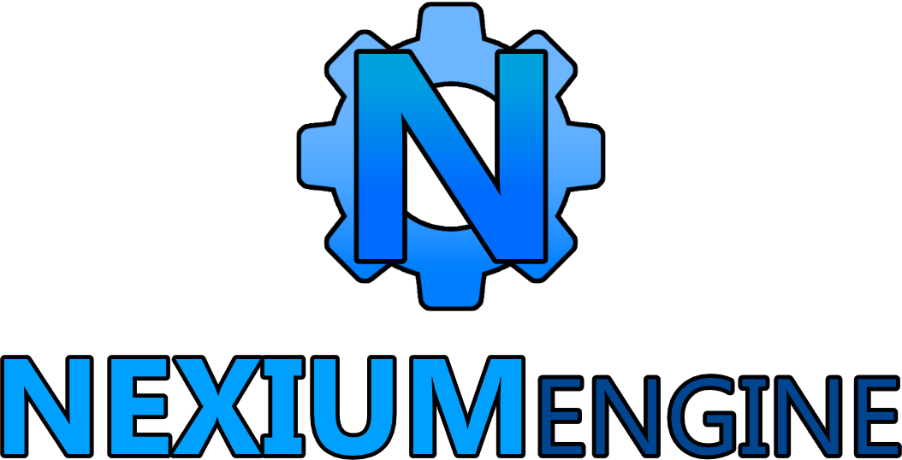

# Aurora3D

Uma biblioteca 3D pequena e autossuficiente para **C++20**, construída direto sobre
**DirectX 12**, com **HLSL** de primeira classe. O modelo de programação é
*immediate-mode*, no espírito do raylib: funções curtas, verbos diretos, zero
boilerplate. A API, os nomes e a implementação são próprios — é "estilo raylib",
não um clone.

```cpp
#include <aurora/aurora.h>

int main() {
    a3d::Config config;
    config.title = "Meu jogo";
    if (!a3d::Init(config)) return 1;

    a3d::OrbitCamera orbit;

    while (!a3d::WindowShouldClose()) {
        a3d::UpdateOrbitCamera(orbit);

        a3d::BeginScene(orbit.ToCamera());
        a3d::DrawGrid();
        a3d::DrawCube({0, 0.5f, 0}, {1, 1, 1}, a3d::colors::Orange);
        a3d::EndScene();
    }

    a3d::Close();
    return 0;
}
```

Esse é o programa inteiro: janela, dispositivo D3D12, swap chain, câmera, luz,
desenho e sincronização de frames. Tudo isso são ~20 linhas de código de aplicação.

## Por que ela existe

O raylib é ótimo para prototipar, mas é OpenGL e não expõe o pipeline moderno. O
DirectX 12 sozinho é poderoso, mas exige centenas de linhas só para abrir uma
janela. Aurora3D fica no meio: a ergonomia de desenhar do raylib, com um pipeline
D3D12 de verdade por baixo — PSOs, root signature, heaps de descritores, frames em
voo — e shaders HLSL que você pode escrever e recarregar em tempo real.

## Instalação

Só Windows. DirectX 12 não tem implementação em outro sistema.

**Requisitos:** Windows 10/11, CMake 3.20+, um compilador C++20 (MSVC 2019+ ou
MinGW-w64 GCC 13+) e o Windows SDK.

```sh
cmake -B build -DCMAKE_BUILD_TYPE=Release
cmake --build build --config Release
```

Isso gera `aurora3d.lib` (ou `libaurora3d.a`) e os seis exemplos em `build/`.

Para usar em outro projeto CMake:

```cmake
add_subdirectory(third_party/Aurora3D)
target_link_libraries(meu_jogo PRIVATE aurora3d)
```

Ou manualmente, com MinGW-w64:

```sh
x86_64-w64-mingw32-g++ -std=c++20 -Iinclude -Isrc meu_jogo.cpp \
    src/*.cpp src/internal/*.cpp \
    -ld3d12 -ldxgi -ld3dcompiler -lwindowscodecs -lole32 -luuid \
    -luser32 -lgdi32 -lshcore -lxinput -lxaudio2_8 \
    -lmfplat -lmfreadwrite -lmfuuid -o meu_jogo.exe
```

## Como se usa

### A câmera é sua

A biblioteca nunca guarda uma câmera. Você monta uma `a3d::Camera3D` e passa para
`BeginScene()` a cada frame, o que mantém a lógica de câmera no seu código.

```cpp
a3d::Camera3D camera;
camera.position = {0, 3, -8};
camera.target   = {0, 1, 0};
camera.fovY     = 60.0f;

a3d::BeginScene(camera);
```

Para câmeras orbitais existe um controlador pronto, que já lê mouse e teclado:

```cpp
a3d::OrbitCamera orbit;
orbit.distance = 10.0f;

// por frame:
a3d::UpdateOrbitCamera(orbit);   // arrastar = olhar, roda = zoom, WASD = mover
a3d::BeginScene(orbit.ToCamera());
```

### Desenho immediate-mode

Tudo que você chama entre `BeginScene()` e `EndScene()` é **enfileirado**, não
enviado na hora. No fim do frame a biblioteca ordena e submete tudo de uma vez:

1. geometria opaca, ordenada por estado de pipeline (menos trocas de PSO)
2. geometria transparente, ordenada de trás para frente (blending depende da ordem)
3. linhas de debug, agrupadas em um único draw call
4. overlay 2D, ortográfico, sem teste de profundidade

Você escreve na ordem que quiser; a ordem de desenho correta é problema da
biblioteca.

```cpp
a3d::BeginScene(camera, a3d::colors::SkyBlue);

// primitivas de uma linha
a3d::DrawCube({0, 1, 0}, {1, 1, 1}, a3d::colors::Orange);
a3d::DrawSphere({3, 1, 0}, 1.0f, a3d::colors::Green);
a3d::DrawCylinder({-3, 1, 0}, 0.5f, 2.0f, a3d::colors::Blue);
a3d::DrawPlane({0, 0, 0}, {20, 20}, a3d::colors::DarkGray);
a3d::DrawCone({0, 2, 5}, 0.5f, 1.5f, a3d::colors::Red);

// malhas com transformação
const a3d::Mesh* mesh = a3d::GetSphereMesh(1.0f);
a3d::DrawMesh(mesh, {0, 2, 0}, a3d::Vec3{0, 45, 0}, a3d::Vec3{2, 2, 2});

// ou com uma matriz explícita
a3d::Mat4 world = a3d::Compose(position, rotation, scale);
a3d::DrawMeshEx(mesh, world, a3d::colors::White);

// material com textura e parâmetros
a3d::Texture* tex = a3d::LoadTextureFromFile("chao.png");
a3d::DrawMeshMaterial(mesh, {0, 0, 0}, tex, {}, {}, a3d::colors::White, 0.8f, 0.2f);

// debug
a3d::DrawGrid(10.0f, 20, a3d::colors::DarkGray);
a3d::DrawAxes({}, 2.0f);
a3d::DrawLine({0, 0, 0}, {0, 5, 0}, a3d::colors::Yellow);
a3d::DrawBounds(a3d::MeshBounds(mesh), a3d::colors::Green);

// overlay 2D, em pixels, origem no canto superior esquerdo
a3d::DrawScreenRect({10, 10}, {200, 40}, a3d::colors::Black);
a3d::DrawScreenLine({10, 60}, {210, 60}, a3d::colors::White, 2.0f);

a3d::EndScene();
```

### Shaders HLSL

A root signature é fixa, então um shader seu só precisa incluir `aurora.hlsli` e
definir `VSMain` / `PSMain`. Não há `.cso` para compilar junto nem passo de build: a
biblioteca compila o HLSL em tempo de execução.

```cpp
const char* fonte = R"HLSL(
#include "aurora.hlsli"

A3D_VertexOutput VSMain(A3D_VertexInput input) {
    return A3D_TransformVertex(input);
}

float4 PSMain(A3D_VertexOutput input, bool frente : SV_IsFrontFace) : SV_TARGET {
    return float4(input.color.rgb * input.uv.x, input.color.a);
}
)HLSL";

a3d::Shader* meu = a3d::LoadShaderFromMemory(fonte);

a3d::SetShader(meu);
a3d::DrawSphere({0, 1, 0}, 1.0f, a3d::colors::White);
a3d::SetShader(nullptr);   // volta ao shader padrão
```

O que a biblioteca te dá no HLSL:

```hlsl
cbuffer FrameConstants : register(b0)   // viewProj, cameraPosTime, lightDir, ambient
cbuffer ObjectConstants : register(b1)  // world, baseColor, uvScaleOffset, params, flags
Texture2D    albedoTexture : register(t0);
SamplerState albedoSampler : register(s0);
```

Mais os helpers `A3D_TransformVertex()`, `A3D_Shade()` e `A3D_ShadePixel()`, e os
flags `A3D_FLAG_UNLIT`, `A3D_FLAG_TEXTURED` e `A3D_FLAG_TWOSIDED`.

Para editar um shader e ver o resultado sem recompilar o programa:

```cpp
a3d::Shader* s = a3d::LoadShaderFromFile("meu.hlsl", /*watchForChanges=*/true);
// o arquivo é recompilado automaticamente quando muda no disco
```

### Malhas e texturas próprias

```cpp
a3d::Vertex vertices[3] = { ... };
uint32_t indices[3] = {0, 1, 2};
a3d::Mesh* triangulo = a3d::CreateMesh(vertices, 3, indices, 3);

a3d::TextureDesc desc;
desc.width = 256;
desc.height = 256;
desc.pixels = meusPixelsRGBA8;
a3d::Texture* tex = a3d::LoadTexture(desc);

// ...

a3d::UnloadMesh(triangulo);
a3d::UnloadTexture(tex);
```

As primitivas `GetCubeMesh()`, `GetSphereMesh()` etc. são **cacheadas e
compartilhadas** — pedir a mesma duas vezes devolve a mesma malha, e
`UnloadMesh()` nelas não faz nada.

### 2D e texto

`Camera2D` transforma o mesmo desenho immediate-mode para um mundo 2D, com zoom e
rotação, e a conversão tela/mundo serve para picking com o mouse:

```cpp
a3d::Camera2D cam;
cam.offset = {GetScreenWidth() * 0.5f, GetScreenHeight() * 0.5f};
cam.target = jogador.posicao;
cam.zoom   = 2.0f;

a3d::BeginMode2D(cam);
a3d::DrawRectangle(0, 0, 64, 64, a3d::colors::Orange);
a3d::DrawCircleV(inimigo.posicao, 16.0f, a3d::colors::Red);
a3d::DrawPolygon({0, 0}, 6, 40.0f, 0.0f, a3d::colors::Cyan);
a3d::EndMode2D();

// mouse -> mundo
const a3d::Vec2 mundo = cam.ScreenToWorld(a3d::GetMousePosition(),
                                          GetScreenWidth(), GetScreenHeight());
```

Fora de um `BeginMode2D()` as mesmas funções desenham em pixels, com a origem no
canto superior esquerdo — é o que o overlay já usava.

O texto usa uma fonte de bitmap embutida, então não há arquivo de fonte para
distribuir. Tudo o que é texto tem variante `V` (posição em `Vec2`) e aceita
`printf` no `DrawTextFormat()`:

```cpp
a3d::DrawText("pontos: 120", 16, 16, 24.0f, a3d::colors::White);
a3d::DrawTextCentered("game over", GetScreenWidth() * 0.5f, 200.0f, 48.0f, a3d::colors::Red);
a3d::DrawTextFormat(16, 48, 20.0f, a3d::colors::Lime, "fps: %d", GetFps());

const a3d::Vec2 tamanho = a3d::MeasureText("pontos: 120", 24.0f);  // para centralizar você mesmo
```

### Áudio

`Sound` é decodificado na memória; `Music` faz streaming do disco e é alimentado
automaticamente a cada frame. O subsistema é best-effort: sem dispositivo de saída,
o carregamento devolve `nullptr` e o programa continua rodando.

```cpp
a3d::Sound* tiro = a3d::LoadSound("tiro.wav");
a3d::Music* trilha = a3d::LoadMusic("trilha.wav");

a3d::SetMusicVolume(trilha, 0.6f);
a3d::SetMusicLooping(trilha, true);
a3d::PlayMusic(trilha);

// no jogo:
a3d::PlaySound(tiro);                          // reinicia se já estiver tocando
a3d::PlaySoundMulti(passo, /*pitchRange=*/2.0f);  // sobrepõe cópias com pitch variado

a3d::UnloadMusic(trilha);
a3d::UnloadSound(tiro);
```

### Vídeo

`Video` abre um arquivo via Media Foundation e entrega o frame atual como textura.
`UpdateVideo()` avança o decoder uma vez por frame (o `EndScene()` já faz isso).

```cpp
a3d::Video* clip = a3d::LoadVideo("intro.mp4");
a3d::SetVideoLooping(clip, true);
a3d::PlayVideo(clip);

// no jogo, sobre o overlay 2D:
a3d::DrawVideoV(clip, {0, 0});
```

### Modelos

`LoadModel()` lê OBJ/MTL sem dependência extra (com Assimp opcional para outros
formatos) e devolve um modelo com várias partes, cada uma com o seu material:

```cpp
a3d::Model* robo = a3d::LoadModel("robo.obj");

a3d::DrawModel(robo, {0, 0, 0}, a3d::Vec3{0, 90, 0}, a3d::Vec3{1, 1, 1});
a3d::DrawModelEx(robo, a3d::Compose(pos, rot, escala), a3d::colors::White);

a3d::UnloadModel(robo);
```

### Estado de renderização

```cpp
a3d::SetBlendMode(a3d::BlendMode::AlphaBlend);   // Opaque, AlphaBlend, Additive
a3d::SetCullMode(a3d::CullMode::Back);           // Back, Front, None
a3d::SetDepthTest(a3d::DepthTest::Less);         // Less, LessEqual, Always

a3d::SetLightDirection({-0.5f, -1.0f, -0.4f});
a3d::SetAmbient(a3d::colors::White, 0.3f);
```

### Overlay sobre uma cena 3D

`BeginSceneOverlay()` mantém o que já está no buffer de cor (o de profundidade é
limpo), que é como se desenha uma segunda passada por cima:

```cpp
a3d::BeginScene(camera);
a3d::DrawCube({0, 0, 0}, {1, 1, 1});
a3d::EndScene();

a3d::BeginSceneOverlay(camera);
a3d::DrawScreenRect({10, 10}, {200, 40}, a3d::colors::Black);
a3d::EndScene();
```

### Diagnóstico

```cpp
a3d::RenderStats stats = a3d::GetRenderStats();
a3d::LogInfo("%u draw calls, %u triângulos, %u trocas de estado",
             stats.drawCalls, stats.triangles, stats.stateChanges);
```

Para depurar problemas de pipeline, ative a camada de depuração do D3D12 **antes**
do `Init()`:

```cpp
a3d::SetDebugLayerEnabled(true);
```

Erros são reportados por `a3d::LogError()` e por retorno `false`/`nullptr`. A
biblioteca nunca lança exceção pela sua fronteira pública.

## Arquitetura

```
include/aurora/       headers públicos, um por subsistema
  aurora.h            janela, ciclo de vida, tempo, luzes, estatísticas
  draw.h              a API immediate-mode de desenho (3D, 2D e texto)
  camera.h            Camera3D, OrbitCamera
  mesh.h              Vertex, Mesh, primitivas
  texture.h           texturas (arquivo ou memória)
  shader.h            shaders HLSL e estado de pipeline
  audio.h             Sound, Music (XAudio2)
  video.h             Video (Media Foundation)
  model.h             Model, carregado de OBJ/MTL
  input.h             teclado e mouse
  math.h              vetores, matrizes, quatérnios, bounds, raios
  color.h             Color e a paleta
  log.h               log com níveis

src/                  implementação
  internal/           o que só existe no Windows: dispositivo, swap chain,
                      janela Win32, heaps, uploads, root signature
shaders/              HLSL embutido no binário, legível e editável
examples/             seis programas completos
tests/                testes de math, geometria e câmera 2D, rodam nativamente
```

### Decisões que valem saber

**Coordenadas.** Sistema destro (right-handed), profundidade em `[0, 1]`
(convenção nativa do D3D), matrizes **coluna-maior** com vetores coluna. Ou seja,
`M * v` em C++ é exatamente `mul(M, v)` em HLSL com empacotamento padrão — os dois
lados nunca precisam transpor.

**Constantes por root constants.** `b0` e `b1` são enviados como *root constants*,
não CBVs. É o caminho de binding mais barato do D3D12 e dispensa buffer de upload
por frame.

**Frames em voo.** A biblioteca mantém vários frames em voo e usa fence por slot
para não reescrever um buffer que a GPU ainda está lendo. `EndScene()` apresenta e
rotaciona o slot.

**Shaders embutidos.** `tools/embed_shaders.py` transforma `shaders/*.hlsl` em
literais de string compilados no binário, então um programa Aurora3D roda sem
nenhum arquivo de shader ao lado do executável. Os `.hlsl` continuam no disco por
serem a fonte legível — e o que você copia para escrever um shader próprio.

## Exemplos

| Exemplo | O que mostra |
| --- | --- |
| `01_hello_cube.cpp` | cubo girando, grid, linhas, esfera translúcida, overlay 2D |
| `02_custom_shader.cpp` | shader HLSL próprio, gradiente, troca de shader por draw |
| `03_mesh_and_texture.cpp` | malha procedural, textura gerada em código, material |
| `04_2d.cpp` | câmera 2D, formas, sprites e HUD com texto |
| `05_audio_model.cpp` | modelo OBJ, música e efeito sonoro, `BeginShader()` |
| `06_video.cpp` | reprodução de vídeo em um quad com `GetVideoTexture()` |

## Build de desenvolvimento

O sandbox de desenvolvimento é Linux. DirectX 12 é Windows-only, então os programas
**não rodam aqui** — mas dá para type-check e linkar tudo, que é o que pega erro de
API e de ABI sem precisar de GPU:

```sh
./scripts/verify.sh              # cross-compila a biblioteca, exemplos e a API pública
./scripts/verify.sh --warnings   # e trata warning como erro
```

O que **roda de verdade** no Linux é math, cor e geometria, porque não dependem do
Windows:

```sh
./scripts/test-math.sh
```

Ambos os scripts exigem `x86_64-w64-mingw32-g++` (MinGW-w64) e um `g++` nativo. O
build com CMake no Windows é o caminho normal; esses scripts existem para o ciclo
de desenvolvimento aqui.

O `CMakeLists.txt` também pode ser validado a partir do Linux, com um toolchain de
cross-compile:

```sh
cmake -S . -B build -DCMAKE_TOOLCHAIN_FILE=cmake/mingw-w64-toolchain.cmake
cmake --build build
```

## Estado atual

A biblioteca está em desenvolvimento inicial. O que já funciona:

- janela Win32, entrada (teclado, mouse, captura, wheel) e tempo
- dispositivo D3D12, swap chain, heaps, fences, frames em voo
- root signature fixa, cache de PSOs, blend/cull/depth por estado
- compilação de HLSL em runtime, com hot reload opcional
- malhas (estáticas e primitivas) e texturas (WIC e procedurais, com mips)
- renderer immediate-mode com ordenação de transparência e batching de linhas
- desenho 2D: câmera com zoom/rotação, formas, sprites e texto com fonte embutida
- áudio: `Sound` (XAudio2) e `Music` com streaming
- vídeo via Media Foundation, entregue como textura
- modelos OBJ/MTL com materiais (Assimp opcional)
- câmera livre e controlador orbital
- mais de 1100 checagens de teste em math, geometria e câmera 2D

O que ainda **não** existe: sombra, pós-processamento, MSAA configurável, render
para textura, animação/esqueleto e física. A ideia é manter o núcleo pequeno; essas
coisas cabem em cima dele.

## Licença

MIT.
